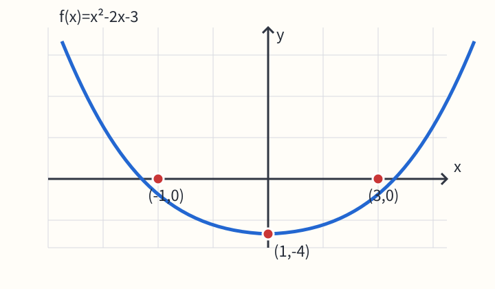

# 教案提纲 - 教师版 - Pandoc


## 教学目标

• 能从解析式读取二次函数的零点和顶点。

• 能用配方法解释图像的平移。

## 活动流程

| 环节 | 活动 | 提示 |
|---|---|---|
| 导入 | 观察二次函数图像 | 先找横轴交点 |
| 探究 | 完成配方 | 核对顶点 |

## 核心例题 Q2

已知 $f(x)=x^{2}-2x-3$，求零点并写出单调递增区间。

{width=320px}

原图待校对：图像与题面解析式存在疑点，请核对原稿。


```{=openxml}
<w:p><w:r><w:br w:type="page"/></w:r></w:p>
```


## C22教师注记-勿发学生

先让学生从图像观察，再要求写出 x=-1 与 x=3。

## C22答案解析

零点为 -1、3；顶点为 $f(x)=(x-1)^{2}-4$；单调递增区间为 [1,+∞)。
