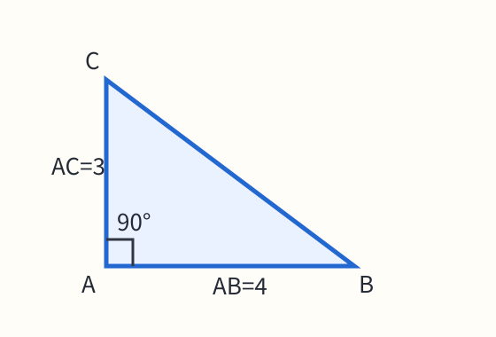
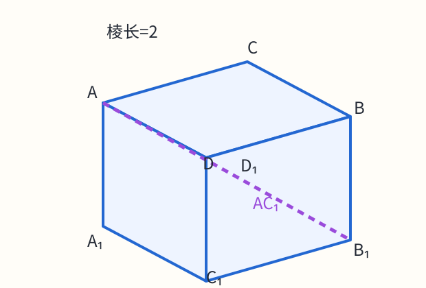

# 练习 - 学生版 - Pandoc


## Q1

求函数 $f(x)=\frac{\sqrt{2x-1}}{x-2}$ 的定义域。

选项 A [1/2,+∞)；B [1/2,2)∪(2,+∞)；C (1/2,2)∪(2,+∞)；D (-∞,2)∪(2,+∞)。

## Q2

已知 $f(x)=x^{2}-2x-3$，配坐标轴与抛物线图，标出顶点和两个横轴交点。

{width=320px}

原图待校对：图像与题面解析式存在疑点，请核对原稿。

（1）求零点；（2）写出单调递增区间。

```{=openxml}
<w:p><w:r><w:br w:type="page"/></w:r></w:p>
```


## Q3

$f(x)=\begin{cases} ax+1 & x<0 \\ x^{2}-1 & x\geq0 \end{cases}$

若 $f(-2)=3$，求 a 和 f(1)。使用真正两行分段公式。

## Q4

解不等式 $\log_{2}(x-1)\leq1$。

```{=openxml}
<w:p><w:r><w:br w:type="page"/></w:r></w:p>
```


## Q5

如图，直角三角形 ABC，∠A=90°。求 BC 的长及 tan B。图中 AB=4，AC=3。

{width=240px}


## Q6

正方体 ABCD-A₁B₁C₁D₁ 的棱长为 2。求体对角线 $AC_{1}$ 的长及体积，并参考空间示意图。

{width=270px}


