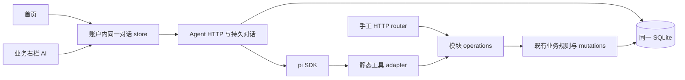

# pi 适配与对话持久化

产品 Agent 暂停。首批行为见[功能规格](../features/agent.md)，字段及工具 journal 见[契约](../contracts/agent.md)。完整六模块扩展与现有代码的区别由功能规格记录。

## 模块与 Interface

沿用 [ADR 0001](../adr/0001-use-a-single-static-module-catalog.md)：React/Vite、Express、同一 SQLite 和编译期静态模块目录。Agent 是外壳能力，位于 `apps/api/src/agent/` 与 `apps/web/src/features/agent/`，不是目录里的第七模块，不新建任务服务、插件平台或事件总线。

首批 Agent 通过统一业务操作接缝调用，不能以裸 service 绕过版本和幂等：工厂返回 `operations`，`operations[operationId]({principal, arguments, key?}) -> {status, body}`，同步返回或抛原 `{status, problem}` 错误；读操作无 key，写操作必需服务端 UUID key。arguments 精确等于 x-agent-tools 中该操作的 parameters，operationId 是该模块封闭集合。该 closure 与 router 共用已有 service/repository 实例。

模块 operations 内负责路径/参数/body 校验、规范操作 method/path、mutations.execute 和业务调用；router 只把已验证 HTTP 身份、header key 和参数投影到 operations。Agent adapter 使用同一 operations，不直接访问 questions/lessons 表、不另造仓储、不通过内部 HTTP 复制 Cookie。原 HTTP 来源/身份门禁仍在 router 外；Agent 的等价身份核验在其受保护入口和每次工具执行前完成。事务 write 内仍同步，网络模型请求在事务之外。

共享接缝的改动须核对手工和 Agent 两个消费者。手工与工具对同输入应得相同 status/body/problem，包括复制读取权、查询过滤、题目/引用版本、deleted、外账户 404、幂等优先顺序和批量取题原子性。工具读副本不使用 C24 固定原题限制；实验 fault/control 参数不进产品。

后续 resources/math/classes/schedule 由各自模块导出同样的有限 operations，已有静态目录声明真实依赖，Agent 本地代码映射显式引入其 tool adapter 和冻结 schema。每次只加实际消费者所需的封闭工具，并补业务一致性场景；不创建任意属性槽位、动态上传扩展、运行时代码安装或插件市场。数学作品的隔离执行由其独立契约负责，不能把任意 shell 加到 Agent。

## 持久化、重启与身份

| 持久内容 | 拥有者与不变量 |
| --- | --- |
| 对话、草稿、消息/工具调用投影、引用、turn、事件序号 | Agent 的 `agent_` 前缀迁移；账户分区，snapshot 和事件同事务。已发出的 UI 片段必已提交。 |
| pi 原生 entries、会话 ID 与格式/包版本 | 同一 SQLite 内由 Agent 保存，保留原生结构给 SDK，不向浏览器开放 thinking。使用 SessionManager.inMemory(cwd, options, entries) 重建运行上下文，不自研 agent loop；无独立必需 JSONL 文件。 |
| 写操作 journal | Agent 保存完整原体、基线、key、状态和 toolCall 关联；prepared 落盘先于任何业务副作用，模型不能改。 |
| 题目/备课、来源/引用快照、业务幂等记录 | 原业务模块和 mutations；保持旧事务语义，Agent 不拥有其 SQL。 |
| 未上传输入和屏幕现场 | Web 可信账户本地分区，退出锁定，重新确认相同账户才读取；不混入认证身份存储。 |

pi 仍负责 prompt/tool loop 和上下文重建；SQLite 只提供应用持久化。重要顺序必须可注入故障验证：接受用户输入先落库；模型返回完整 toolCall 的原生 entry、prepared 工具投影及写调用的 prepared 操作先落库，executing 持久化后才执行；结果及对应原生 toolResult 先落库再允许下一次 provider 请求。streaming 部分文本作为 UI 投影保存，尚未完整的 tool arguments 不可执行，也不可作为有效 toolCall 重建。聊天正文作为安全文本/Markdown 渲染，转义原始 HTML，不执行消息中的脚本。

同一用户消息、原生 entry、toolCall、操作及结果有稳定关联，重建不追加重复用户输入或重复工具结果。重启后用 SDK 读取原生 entries，缺少结果的已持久 toolCall 按工具投影与写 journal 补相同调用的确定结果、取消或中断 ToolOutcome，再允许新的用户 turn；未经执行的调用取消，只读已执行但无持久结果的明确中断，写入已执行未知的先核实。不得用模型重新生成旧请求体来“修复”历史。此一致性与崩溃恢复须通过产品验证；SDK entries 等值探针只能验证加载能力，不能代替业务恢复证据。

服务端运行中的授权只保留原请求的会话绑定于内存，每次 provider 请求/工具调用重新调用 A11 已有 resolvePrincipal，并比对可信账户；Cookie/密钥不落 Agent 表。浏览器断线不立即撤销会话，退出/到期/重置按原认证规则使后续核验失败；不能把接受 turn 时的 accountKey 当永久授权。重启不恢复内存授权，新请求验证相同账户后才能核实旧操作或发起下一 turn。迟到网络输出按账户代次与 turn 归属丢弃 UI 应用，但真实已提交结果保留在原账户。

工具公开投影沿用同一 Agent 仓储和事件流，无新服务或端点。`(turnId, toolCallId)` 唯一，turn 内 ordinal 唯一；原生 entry 到调用的关联仅在服务端。只读投影拥有其持久结果，写投影由既有 journal 事务维护，同一 operation 的去重调用关联也随之更新。重建 SDK 先补齐缺失的同 ID toolResult，不重新执行只读调用。投影/原生结果/事件的原子边界、停止竞态和失败映射统一见[公开投影语义](../contracts/agent.md#工具调用的公开投影)，C26 注入故障验证。

Agent 迁移只新增，复用共享迁移 runner、同一数据库与幂等设施；空库和 A11/B16 升级库都验证，不改旧迁移。升级 pi/entries 格式前用隔离副本验证重开；未知/损坏 entries 保留原记录，UI 可读投影，生成标不可用，不静默建立空会话覆盖。备份边界为现有 SQLite 加未来模块既有受管文件，已含对话/entries/journal/幂等记录；F62 定义全量导出恢复，C26 不新建备份平台。
