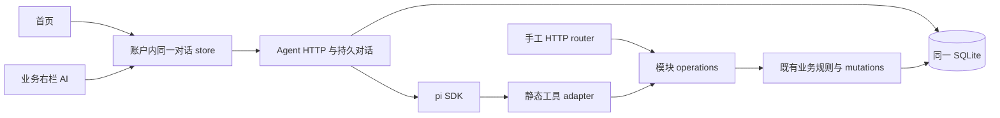

# 早期 Agent 架构与实验裁决

产品 Agent 开发暂停。本页保留设计范围，当前授权及实际交付边界见[Agent 入口](../modules/agent.md)。

本页定义 C25 的技术选择。行为见 [UX](../ux/agent.md)，交换语义见[契约](../contracts/agent.md)，精确字段见 [OpenAPI](../contracts/agent.openapi.json)。

## 固定输入与裁决

固定引用采用 `完整 SHA:仓库相对路径`，用 `git show <SHA>:<path>` 消费；工作树目录只用于发现输入，不将其浮动 HEAD 当版本。无需引入实验代码、旧证据或秘密到产品分支。

| 输入 | 固定版本 / 路径 | 能支持的判断 |
| --- | --- | --- |
| 业务设计 | `9aee091a34ba2eb311b51299d9beed78a032d026:docs/contracts/workbench.md`、`docs/arch/first-flow.md` | 原业务、版本、来源/引用、幂等与公开操作语义。 |
| 真实业务候选 | `612f0a9868743a1d5eea7e6f236d3ff903752439`；独立报告 `d1ef0d5af8478677c04e6dd42bd3346f7883d1d0:docs/acceptance/evidence/B16/v1/attempt2.md` | 首流真实 HTTP/页面与 SQLite 已通过，身份仅 test-principal。 |
| 认证 | `6f3003250d170b44e89f6ac9b0a74f91d658a357:docs/contracts/auth.md`、`auth.openapi.yaml`、`workbench/first-flow.openapi.yaml`；独立冻结 `63bfe8f7900b4a2bb7fc9ab5a4145f1c89a6f73b:docs/acceptance/evidence/AUTH-CONTRACT/v1/correction-review.md` | 真实身份契约、页面绑定与来源保护；不是已验真实认证能力。 |
| 认证产品接续 | `9ecabbf60cbbaecce2e9be8191d270068eb675cf`；A12 本地报告 `aaa3d77accbfc743f47edfb1ffc385735b2bf3db:docs/acceptance/evidence/A12/v1/local-recheck.md` | real-api/fake-mail 的本地 independent PASS，可供后续集成；真实邮件、目标设备及外部门禁仍未通过，不是 A12 整体 PASS。 |
| 实验修复 | `e8fdf9a139e429c05590925647a433a9da382579:docs/acceptance/evidence/C24/v1/business-fix.md` 及 `experiments/C24/business/fix-attempt1/` | 修复后的读回与历史接续；具体限度见下一节。 |
| 保留切片 | `d826b72b2c8d4bec8360b82efa7d46eeb58c56ac:experiments/C24/business/runs/deepseek-deepseek-v4.1-flash/`；基础探针 `e7f979bd80ab83aaab7cc2cf936250123d7742a3:docs/arch/evidence/C24.md` | 旧失败与通过切片分别消费，不以旧报告结尾替代轨迹。两者都在修复候选历史中。 |

当前工作树认证/工作台 schema 对上述认证源的差异仅为冻结状态说明，不是业务变更；本批新增 schema 的外部引用继续使用这些既有 schema。B11 的旧 test-principal 与新版真实页面头并非同一验收范围。最小裁决：C26 消费新版头与真实 principal，保留旧业务 body 和操作语义，不要求重写 B11 或等 A12 才设计。

## 实验消费结论

C25 已读取真实 JSONL、HTTP 工具日志、copy-history、前后结果和失败切片，并执行零模型本机复核。[本批复核索引](../acceptance/evidence/C25/v1/checks.md)给出实际命令、输出和局限。

| 切片 | 结论和边界 | 接入裁决 |
| --- | --- | --- |
| PI-01/02 两模型 | 允许模型均有真实非空输出、usage、无副作用工具循环；基础探针不是业务能力。 | 两精确 ID 可注册；GLM 真实题库/备课写入尚待 C26/C27。 |
| 未知模型 | CLI 对 not-allowed-model 实际发出请求并被 provider 400 拒绝；SDK getModel 不注册未知 ID。 | 产品走 SDK 严格白名单，创建/重开/请求前再次检查，任何 fallback 都不发送。 |
| PI-03 | 旧记录两次相同 keyHash/payloadHash/ID，副本持久；旧读回 FAIL。修复后 pi 原会话新增 3 次工具调用、0 次复制，读回完整副本与报告中的 HTTP 对象一致，来源 v1。 | 采信修复后读回和旧幂等切片；不重写旧 FAIL。 |
| PI-04 冲突 | 旧人工修改后原题 v2，复制基线 v1 返回 409；未创建冲突副本。旧轨迹中模型根据内容报告冲突，但持久 isError=false。 | 业务冲突规则成立；错误标志映射必须在产品中修正。 |
| PI-04 中断 | 提交后 SIGTERM，重开用同键同体获得同 ID；修复接续前缀逐字保留，补一次重放和读回，来源 v2。 | 支持已测恢复路径；未证明任意崩溃时刻原体都可恢复。实验有内存 payloadCache，重开会重新读源组体，只有本样本源未变时哈希一致。产品必须先持久化原体。 |
| pi 错误 | C25 零 provider 重做正常返回/抛错/afterToolCall 覆盖：外层与持久标志分别 false/true/true。 | 采用结构化 details + afterToolCall 外层映射；合成 assistant 仅证明 runtime 机制，不证明模型理解。 |
| 持久重开 | 六份固定会话在无凭据下恢复 2/2/4/4/29/24 条消息，模型 unknown 且提示无可用模型；两份业务会话通过 inMemory(entries) 与 open 的完整 context/ID 等值检查。 | 历史加载与模型就绪分开；可由 SQLite 保存原生 entries 并用 SDK 重建，无需第二个持久真相。 |
| 页面与隔离 | 旧/修复 self 证据显示副本唯一、刷新仍在、账户 B 搜索空/读取 404；C25 未重开产品浏览器或真实 HTTP。 | 作为设计材料消费；不升级为 C27、real-auth 或新设备 PASS。 |
| 用量 | 修复 7 请求/36651 tokens；真业务累计 32 请求/93970 tokens，基础探针及非法请求另存旧记录。cost 元数据均 0，账单/余额未知。 | 不显示免费或账单 0；本批新增产品模型请求为 0。 |

判断：实验足以支持沿用 pi SDK 和既有业务规则完成有边界的 C26 产品实现；不支持宣布早期 Agent 已交付。未覆盖的完整错误 hook 接线、断流恢复、服务端原请求持久化、备课写入、GLM 业务行为、真实认证和新样本由 C26 自检及 C27 独立验收承担。

旧模型解释中的“键已用于失败请求，不宜复用”不是业务事实，失败不消耗成功幂等记录，规则仍归冻结契约。实验复制主要证明服务调用、来源与持久化，不能证明任意数学题的改编质量；新要求与数学内容准确性由 C27 使用未固定样本验收。

## 模块与 Interface

沿用 [ADR 0001](../adr/0001-use-a-single-static-module-catalog.md)：React/Vite、Express、同一 SQLite 和编译期静态模块目录。Agent 是外壳能力，位于 `apps/api/src/agent/` 与 `apps/web/src/features/agent/`，不是目录里的第七模块，不新建任务服务、插件平台或事件总线。

B16 实际工厂只把 service factory 导出，router 持有 schema 与 mutations，Agent 不能直接调用裸 service 绕开版本前置/幂等。C26 为两个模块新增同一个小 Interface：工厂返回 `operations`，`operations[operationId]({principal, arguments, key?}) -> {status, body}`，同步返回或抛原 `{status, problem}` 错误；读操作无 key，写操作必需服务端 UUID key。arguments 精确等于 x-agent-tools 中该操作的 parameters，operationId 是该模块封闭集合。该 closure 与 router 共用已有 service/repository 实例。

模块 operations 内负责路径/参数/body 校验、规范操作 method/path、mutations.execute 和业务调用；router 只把已验证 HTTP 身份、header key 和参数投影到 operations。Agent adapter 使用同一 operations，不直接访问 questions/lessons 表、不另造仓储、不通过内部 HTTP 复制 Cookie。原 HTTP 来源/身份门禁仍在 router 外；Agent 的等价身份核验在其受保护入口和每次工具执行前完成。事务 write 内仍同步，网络模型请求在事务之外。

这是唯一必要的共享新增接缝，归 C26 独占。手工与工具对同输入应得相同 status/body/problem，包括复制读取权、查询过滤、题目/引用版本、deleted、外账户 404、幂等优先顺序和批量取题原子性。工具读副本不使用 C24 固定原题限制；实验 fault/control 参数不进产品。

后续 resources/math/classes/schedule 由各自模块导出同样的有限 operations，已有静态目录声明真实依赖，Agent 本地代码映射显式引入其 tool adapter 和冻结 schema。每次只加实际消费者所需的封闭工具，并补业务一致性场景；不创建任意属性槽位、动态上传扩展、运行时代码安装或插件市场。数学模块以后如何隔离执行作品由其独立契约负责，不能把任意 shell 加到 Agent。

## 持久化、重启与身份

| 持久内容 | 拥有者与不变量 |
| --- | --- |
| 对话、草稿、消息/工具调用投影、引用、turn、事件序号 | Agent 的 `agent_` 前缀迁移；账户分区，snapshot 和事件同事务。已发出的 UI 片段必已提交。 |
| pi 原生 entries、会话 ID 与格式/包版本 | 同一 SQLite 内由 Agent 保存，保留原生结构给 SDK，不向浏览器开放 thinking。使用 SessionManager.inMemory(cwd, options, entries) 重建运行上下文，不自研 agent loop；无独立必需 JSONL 文件。 |
| 写操作 journal | Agent 保存完整原体、基线、key、状态和 toolCall 关联；prepared 落盘先于任何业务副作用，模型不能改。 |
| 题目/备课、来源/引用快照、业务幂等记录 | 原业务模块和 mutations；保持旧事务语义，Agent 不拥有其 SQL。 |
| 未上传输入和屏幕现场 | Web 可信账户本地分区，退出锁定，重新确认相同账户才读取；不混入认证身份存储。 |

pi 仍负责 prompt/tool loop 和上下文重建；SQLite 只提供应用持久化。重要顺序必须可注入故障验证：接受用户输入先落库；模型返回完整 toolCall 的原生 entry、prepared 工具投影及写调用的 prepared 操作先落库，executing 持久化后才执行；结果及对应原生 toolResult 先落库再允许下一次 provider 请求。streaming 部分文本作为 UI 投影保存，尚未完整的 tool arguments 不可执行，也不可作为有效 toolCall 重建。聊天正文作为安全文本/Markdown 渲染，转义原始 HTML，不执行消息中的脚本。

同一用户消息、原生 entry、toolCall、操作及结果有稳定关联，重建不追加重复用户输入或重复工具结果。重启后用 SDK 读取原生 entries，缺少结果的已持久 toolCall 按工具投影与写 journal 补相同调用的确定结果、取消或中断 ToolOutcome，再允许新的用户 turn；未经执行的调用取消，只读已执行但无持久结果的明确中断，写入已执行未知的先核实。不得用模型重新生成旧请求体来“修复”历史。此一致性与崩溃恢复为 C26 必须实现和 C27 必须验证的产品行为，本批 entries 等值探针只验证 SDK 加载能力。

服务端运行中的授权只保留原请求的会话绑定于内存，每次 provider 请求/工具调用重新调用 A11 已有 resolvePrincipal，并比对可信账户；Cookie/密钥不落 Agent 表。浏览器断线不立即撤销会话，退出/到期/重置按原认证规则使后续核验失败；不能把接受 turn 时的 accountKey 当永久授权。重启不恢复内存授权，新请求验证相同账户后才能核实旧操作或发起下一 turn。迟到网络输出按账户代次与 turn 归属丢弃 UI 应用，但真实已提交结果保留在原账户。

工具公开投影沿用同一 Agent 仓储和事件流，无新服务或端点。`(turnId, toolCallId)` 唯一，turn 内 ordinal 唯一；原生 entry 到调用的关联仅在服务端。只读投影拥有其持久结果，写投影由既有 journal 事务维护，同一 operation 的去重调用关联也随之更新。重建 SDK 先补齐缺失的同 ID toolResult，不重新执行只读调用。投影/原生结果/事件的原子边界、停止竞态和失败映射统一见[公开投影语义](../contracts/agent.md#工具调用的公开投影)，C26 注入故障验证。

Agent 迁移只新增，复用共享迁移 runner、同一数据库与幂等设施；空库和 A11/B16 升级库都验证，不改旧迁移。升级 pi/entries 格式前用隔离副本验证重开；未知/损坏 entries 保留原记录，UI 可读投影，生成标不可用，不静默建立空会话覆盖。备份边界为现有 SQLite 加未来模块既有受管文件，已含对话/entries/journal/幂等记录；F62 定义全量导出恢复，C26 不新建备份平台。

## 缺口归属与最小裁决

| 项 | 归属 / 最小处理 |
| --- | --- |
| 实验嵌套 isError 与持久 false | C25 冻结映射，C26 通过真实 SDK 工具边界修正，C27 复核；不改 C24 旧轨迹。 |
| 实验重开重新组体仅对固定样本有效 | C25 定义原请求 journal；C26 在 source 内容改变之后重放的故障用例证明按原体确认，不能拿已有哈希相同省略此测试。 |
| 认证本地 independent PASS、真实邮件/设备未验 | C26 集成固定认证产品并记录差异和身份模式；C27 的真实身份依据及 A12 外部项仍由原认证责任链提供。 |
| 账单、余额、extra credits 未知 | 只展示实际返回的 usage 和未知费用；由费用/部署拥有者提供事实后再扩展展示，不阻塞零模型实现或设计冻结。 |
| 其他模块尚未接入 | 本批固定静态方式，后续模块节点按各自真实契约接入；完整 MVP 放行仍需要六模块，不用 C27 代替。 |

未发现需要改写冻结认证或旧业务操作的矛盾。普通代码组织、SQL 结构、UI 组件拆分与内部 SDK 适配细节由 C26 决定，但必须满足上述事务和失败语义。共享文件写入权与启动门禁只见[任务包](../plans/tasks/agent-implementation.md)。
