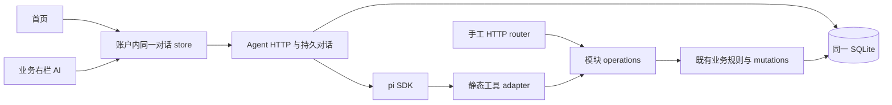

# 产品助理：对话与真实业务操作

这是产品内助理，不是开发 Codex。当前实现与扩展暂停，下面是有效行为规格，不授权模型调用。首批工具和六模块完整工具的边界见契约；已装配的代码不能当作全范围完成。

## 入口与布局

首页完整工作区与业务页右栏挂接同一个按可信账户分区的对话 store，选中的 conversationId、消息、引用、输入和发送状态只有一份。顶栏首页打开完整工作区；业务页通过右侧 AI 切换进入。全站入口位置沿[共同交互](../WORKBENCH_DESIGN.md#整体结构)，不恢复已取消的侧栏底部入口。首页不另开右侧 AI，也不增加第七个模块。

```text
首页                              题库 / 备课
┌全局入口┬对话标题  历史  新对话┐  ┌全局入口┬列表 / 文稿────┬工具│AI┐
│        │消息与操作结果        │  │        │当前对象仍可见  │同对话 │
│导航栏 │引用 chips            │  │导航栏 │独立滚动        │独立滚动│
│        │输入          模型 发送│  │        │                │同输入 │
└────────┴─────────────────────┘  └────────┴────────────────┴───────┘
```

历史在标题旁的紧凑列表中打开，按最近活动排序，标题取首次已发送文字的前 32 个字符；空对话显示“新对话”。新对话显式创建，旧对话可从历史重找。发送过程中可以查看其他对话，但每账户只运行一个生成，发送按钮指向正在运行的对话。切页面、切对话或关闭右栏不会停止生成。

桌面 1440×900：右栏初始 360px，占布局空间，与主区域间留 12px 背景间隙，可调整到 320-480px；若挤压主区域至不足 480px，改用窄屏呈现。首页消息阅读宽度上限 840px，输入与消息左缘对齐。820×1180 Pad：主区域与 320px 右栏能容纳时并排，否则工具/AI 在同一可关闭辅助面板中显示，保留返回主工作区动作。390px 宽度只要求基本读写，辅助面板占当前内容区，外壳不横向滚动。长公式或代码只在其阅读区内处理宽度，不能推出整页。

使用已有白色底、深色选中态、少量紫色、14/20 正文和紧凑控件；圆角、边线、弹层出现与 reduced-motion 直接遵循设计规则。首页消息、业务列表、文稿、AI 分区各自滚动。用户停在旧消息时不自动拉到底部，显示“有新消息”；已在底部时跟随生成。不能给每张操作卡加独立滚动框。

## 页面往返与引用

普通浏览、切题和筛选保持 AI 选中；明确进入业务编辑可切到工具，AI 草稿继续保留。工具的分类、目录、展开位置、选择、业务草稿和滚动归原业务现场 store，不写入 Agent 草稿。设置/帮助/更新日志使用既有独立布局；导航从这些支持页进入首页，并保留返回支持页的位置。

当前题目或备课内容旁提供“加入对话”，将已保存对象版本加入输入区可移除的引用 chip；发送前可打开核对。仅浏览不自动引用，不把未保存编辑内容冒充服务端版本。存在未保存业务输入时，“加入对话”说明它引用已保存版本，并可先回业务保存。引用选中环节时保留 lessonId、sectionId；环节被移除则要求重新选择，不猜一个新环节。

发送时服务器核对引用归属和版本并捕获快照；历史引用继续显示当时内容。打开当前对象时读取最新对象，标明更新或已删除；无法访问时保持消息里的既有快照，显示“当前内容不可用”。跨账户不能返回快照。操作成功卡包含真实对象、版本和“打开题目/备课”，打开后保留对话及原业务现场。Agent 改到当前正在编辑的对象时，干净编辑器可刷新；有本地草稿只提示“内容有更新”，保留双份内容供对照，不替换输入。

## 输入、生成与保存

输入草稿与引用在停止输入后保存，输入区明确区分“保存中”“草稿已保存”“仅保留在此设备”。本地先按账户保留，再写服务器；服务器确认的草稿可在其他设备恢复。本地未上传草稿只保证当前设备恢复，不能显示云端已保存。

发送先确认这一版草稿持久化，再提交一次 turn。等待发送确认时保持原内容；确认成功才清除对应版本，新打的下一条输入独立保留。网络断开后同键重试发送不新增消息或模型请求。另一设备修改同一草稿时显示两份，老师选“保留本机内容”或“采用已保存内容”；两者都先读最新版本，采用本机内容才用新键提交，不后台合并。

正文显示流式文本，状态行显示“生成中”，工具卡分别显示查找、写入进行中、已保存、失败、结果待确认。模型文字不能把失败卡改成成功。每次完整已持久化文本片段才推送，刷新可重读这些片段；最后尚未落盘的 token 不承诺恢复。读取持久记录失败显示重试，不显示空会话、不覆盖本地草稿。

只读与写入均从持久 toolCalls 呈现一张工具卡，按所属 turn 的 ordinal 排序；失败详情包含工具动作、已校验参数和公开 Problem，即使没有后续模型文字也独立显示。只读开始显示“查找中”，成功显示本次实际结果，空列表明确“未找到”；失败、未执行和读取中断分别显示。刷新/重登不触发重查，保留原结果快照和失败详情。写卡关联原 operationId，“确认结果”仅用于待确认写入，同一操作的复用卡标明引用同一提交。

“停止”立即停止后续模型请求与尚未开始的工具，已开始的写入先核实结果。停止不是回滚；已保存结果保留，未确认结果仍提供“确认结果”。网络断开只重连消息，不自动新增一轮生成。服务器重启后保留部分回答，显示“上次生成已中断”；先确认未决写入，再由老师发送“继续”，形成新 turn。失败重试也通过明确再次发送完成，已完成业务操作不会因继续而重做。

## 失败与模型

| 情况 | 可见结果与恢复动作 |
| --- | --- |
| 写入结果待确认 | 保留操作目标和原请求，点击“确认结果”执行原键原体核实，不调用模型；未确认前不再开始生成。 |
| 业务版本或引用版本冲突 | “内容已被修改”，展示请求基线及最新对象的对照入口；保留提案，老师手工整理保存，或明确重新发起基于新版的请求。 |
| 某一步失败 | 逐步显示已成功与未执行部分；例如复制成功、加入备课冲突，不回滚副本、不报告整个任务完成。 |
| 401、退出待确认或账户切换 | 沿认证流程锁住工作区并停止生成；旧流立即隐藏，相同账户验证成功后恢复其历史和待确认操作。 |
| 配置缺失/模型不可用 | 历史与草稿可读，禁用发送并显示“AI 暂不可用”；不提示在聊天框填写密钥。 |
| 额度/计费授权失败 | 停止自动请求，保留部分回答与工具结果，显示“模型调用被拒绝”；配置处理完成后由老师重试。 |
| 模型或网络错误 | 显示失败或中断，不自动换模型，不无限重试。工具结果独立保留。 |
| 上下文超限 | 保留完整历史，提示“这段对话过长，请新建对话并重新选择引用”；不静默丢弃旧消息。 |

模型选择只列两个精确 ID 对应的名称，默认 DeepSeek；GLM 显示其当前配置就绪状态。选择对下一次发送生效，不改已有 turn 的模型。用量详情放在每个 turn 的状态旁：仅列已报告 token，并把缺失部分标为“用量不完整”。当前账单、余额和单价未知时费用显示“实际费用未知”，不能显示 ¥0、免费或虚构余额，不照搬套餐/订阅 UI。

## 视觉验收入口

C26/C27 用真实题目与备课检查 1440×900、820×1180 和 390×844：首页、AI/工具切换、长对话与公式、历史弹层、草稿失败、冲突、停止/重连、操作结果打开后返回。截图与实际指针/键盘操作一起留证；测主要区域滚动独立、外壳无横向溢出、按钮可点击、焦点返回和新消息提示。既有原型只提供入口关系，未继承其固定回答或验收结论。

## 实现与接续边界

首批字段和 journal/SSE/停止语义见[Agent 契约](../contracts/agent.md)，持久化及 pi 接缝见[助理实现](#助理实现)。Web `apps/web/src/features/agent/`，API `apps/api/src/agent/`。完整六模块工具行为见[扩展契约](../contracts/agent.md#六模块扩展契约)，其精确 schema 按该节固定版本读取。

该扩展已独立冻结，不能重新派工具分类设计，也不能把 81 个工具的设计清单当实现完成。恢复时核对旧/新路径、工具卡 read/write 分类、恢复隔离和真实端口；当前模型白名单、预算和 Provider 条件见[模型接入](#模型接入)。现有 live 验证入口会产生真实请求，须有新授权窗口。

## 助理实现

### 模块与 Interface

沿用 [ADR 0001](../adr/0001-use-a-single-static-module-catalog.md)：React/Vite、Express、同一 SQLite 和编译期静态模块目录。Agent 是外壳能力，位于 `apps/api/src/agent/` 与 `apps/web/src/features/agent/`，不是目录里的第七模块，不新建任务服务、插件平台或事件总线。



首批 Agent 通过统一业务操作接缝调用，不能以裸 service 绕过版本和幂等：工厂返回 `operations`，`operations[operationId]({principal, arguments, key?}) -> {status, body}`，同步返回或抛原 `{status, problem}` 错误；读操作无 key，写操作必需服务端 UUID key。arguments 精确等于 x-agent-tools 中该操作的 parameters，operationId 是该模块封闭集合。该 closure 与 router 共用已有 service/repository 实例。

模块 operations 内负责路径/参数/body 校验、规范操作 method/path、mutations.execute 和业务调用；router 只把已验证 HTTP 身份、header key 和参数投影到 operations。Agent adapter 使用同一 operations，不直接访问 questions/lessons 表、不另造仓储、不通过内部 HTTP 复制 Cookie。原 HTTP 来源/身份门禁仍在 router 外；Agent 的等价身份核验在其受保护入口和每次工具执行前完成。事务 write 内仍同步，网络模型请求在事务之外。

共享接缝的改动须核对手工和 Agent 两个消费者。手工与工具对同输入应得相同 status/body/problem，包括复制读取权、查询过滤、题目/引用版本、deleted、外账户 404、幂等优先顺序和批量取题原子性。工具读副本不使用 C24 固定原题限制；实验 fault/control 参数不进产品。

resources/math/classes/schedule 已有各自公共 operations；待恢复的全模块 Agent 接续负责消费这些端口，按静态目录显式映射 tool adapter 和已冻结的扩展 schema，不重新设计业务提供方。每次只加实际消费者所需的封闭工具，并补业务一致性场景；不创建任意属性槽位、动态上传扩展、运行时代码安装或插件市场。数学作品的隔离执行由其独立契约负责，不能把任意 shell 加到 Agent。

### 持久化、重启与身份

| 持久内容 | 拥有者与不变量 |
| --- | --- |
| 对话、草稿、消息/工具调用投影、引用、turn、事件序号 | Agent 的 `agent_` 前缀迁移；账户分区，snapshot 和事件同事务。已发出的 UI 片段必已提交。 |
| pi 原生 entries、会话 ID 与格式/包版本 | 同一 SQLite 内由 Agent 保存，保留原生结构给 SDK，不向浏览器开放 thinking。使用 SessionManager.inMemory(cwd, options, entries) 重建运行上下文，不自研 agent loop；无独立必需 JSONL 文件。 |
| 写操作 journal | Agent 保存完整原体、基线、key、状态和 toolCall 关联；prepared 落盘先于任何业务副作用，模型不能改。 |
| 题目/备课、来源/引用快照、业务幂等记录 | 原业务模块和 mutations；保持旧事务语义，Agent 不拥有其 SQL。 |
| 未上传输入和屏幕现场 | Web 可信账户本地分区，退出锁定，重新确认相同账户才读取；不混入认证身份存储。 |

pi 仍负责 prompt/tool loop 和上下文重建；SQLite 只提供应用持久化。重要顺序必须可注入故障验证：接受用户输入先落库；模型返回完整 toolCall 的原生 entry、prepared 工具投影及写调用的 prepared 操作先落库，executing 持久化后才执行；结果及对应原生 toolResult 先落库再允许下一次 provider 请求。streaming 部分文本作为 UI 投影保存，尚未完整的 tool arguments 不可执行，也不可作为有效 toolCall 重建。聊天正文作为安全文本/Markdown 渲染，转义原始 HTML，不执行消息中的脚本。

同一用户消息、原生 entry、toolCall、操作及结果有稳定关联，重建不追加重复用户输入或重复工具结果。重启后用 SDK 读取原生 entries，缺少结果的已持久 toolCall 按工具投影与写 journal 补相同调用的确定结果、取消或中断 ToolOutcome，再允许新的用户 turn；未经执行的调用取消，只读已执行但无持久结果的明确中断，写入已执行未知的先核实。不得用模型重新生成旧请求体来“修复”历史。此一致性与崩溃恢复须通过产品验证；SDK entries 等值探针只能验证加载能力，不能代替业务恢复证据。

服务端运行中的授权只保留原请求的会话绑定于内存，每次 provider 请求/工具调用重新调用 A11 已有 resolvePrincipal，并比对可信账户；Cookie/密钥不落 Agent 表。浏览器断线不立即撤销会话，退出/到期/重置按原认证规则使后续核验失败；不能把接受 turn 时的 accountKey 当永久授权。重启不恢复内存授权，新请求验证相同账户后才能核实旧操作或发起下一 turn。迟到网络输出按账户代次与 turn 归属丢弃 UI 应用，但真实已提交结果保留在原账户。

工具公开投影沿用同一 Agent 仓储和事件流，无新服务或端点。`(turnId, toolCallId)` 唯一，turn 内 ordinal 唯一；原生 entry 到调用的关联仅在服务端。只读投影拥有其持久结果，写投影由既有 journal 事务维护，同一 operation 的去重调用关联也随之更新。重建 SDK 先补齐缺失的同 ID toolResult，不重新执行只读调用。投影/原生结果/事件的原子边界、停止竞态和失败映射统一见[公开投影语义](../contracts/agent.md#工具调用的公开投影)，C26 注入故障验证。

Agent 迁移只新增，复用共享迁移 runner、同一数据库与幂等设施；空库和 A11/B16 升级库都验证，不改旧迁移。升级 pi/entries 格式前用隔离副本验证重开；未知/损坏 entries 保留原记录，UI 可读投影，生成标不可用，不静默建立空会话覆盖。备份边界为现有 SQLite 加未来模块既有受管文件，已含对话/entries/journal/幂等记录；F62 定义全量导出恢复，C26 不新建备份平台。

## 模型接入

产品使用 pi SDK 的 Command Code `openai-completions` adapter，官方 base URL 为 `https://api.commandcode.ai/provider/v1`，Chat Completions 路径 `/chat/completions`。后端使用私有 `COMMANDCODE_API_KEY`，前端不接收密钥；配置模板 [.env.agent.example](../../.env.agent.example)，实际加载见 `apps/api/src/agent/` 与启动配置。

<a id="allowed-models"></a>
### 模型白名单

仅允许 `deepseek/deepseek-v4.1-flash` 和 `z-ai/glm-5.3-flash`。精确 ID 在创建、恢复和发请求前校验，不用相似名字或其他目录项 fallback。开发 Codex 模型路由另见[执行约定](../plans/execution-protocol.md#模型与固定派发)。

已有具名探针和首批业务工具结果，不再是“仅配置准备、尚未接通”。这些结果不证明完整六模块、任意数学质量、当前余额或未来可用性。产品 Agent 当前暂停，C21 在线窗口关闭，本地 OCR 权重也未获准，见[台账](../plans/run-state.md)。

### 费用与未决

GOAT API 消耗账户 credits，不等于无限免费；Provider 返回 cost=0 不证明账单为零。余额、额外 credits、自动充值和实际费用未知。真实调用需当前任务的明确请求/轮次/token 上限；旧未用额度不结转，新 session 不重置消耗。`responses`、思考开关、视觉能力及流式参数必须有精确 Provider/模型实证，不能从原厂文档或目录名字推导。

| 已关闭窗口 | 已记录消耗与保留未知 |
| --- | --- |
| C21 在线 | 19 次、16 份 usage、108777 已知 completion；3 份缺失及 online-1 预留 8000 未知；新增许可 0 |
| C24 真业务 | 32 次、93970 total；早期探针/非法请求另计，原始 `e8fdf9a139e429c05590925647a433a9da382579:docs/acceptance/evidence/C24/v1/business-fix.md` |
| C26 自验 | 10 次、79983 total；原作者 `ec5094c00d122c77d2acdb376f4ede96eafb13e0` |
| C27 独立 | 11 次、88550 total；live `34e668ae97e1eb0cd5744550b6b05a4c25aa9301`；后继排版复验无新增 |

这不是项目累计总量，更早 EMODEL/C23 以 Git 原回执为准。C21 旧账源为 `2b10b4ecbfef907de1d0c368c7a29eb49af803c4:experiments/C21/page-transcription-1/ledger.json`。

### 外部资料

已有调查日期为 2026-09-21，动态套餐和端点能力在恢复调用前重新核验：[Provider 文档](https://commandcode.ai/docs/provider)、[模型目录](https://commandcode.ai/docs/reference/cli/models)、[GOAT](https://commandcode.ai/docs/plans/goat)、[价格与限制](https://commandcode.ai/docs/resources/pricing-limits)、[Usage](https://commandcode.ai/docs/resources/usage-limits)。不因文档链接存在而查询账户、发请求或购买服务。
