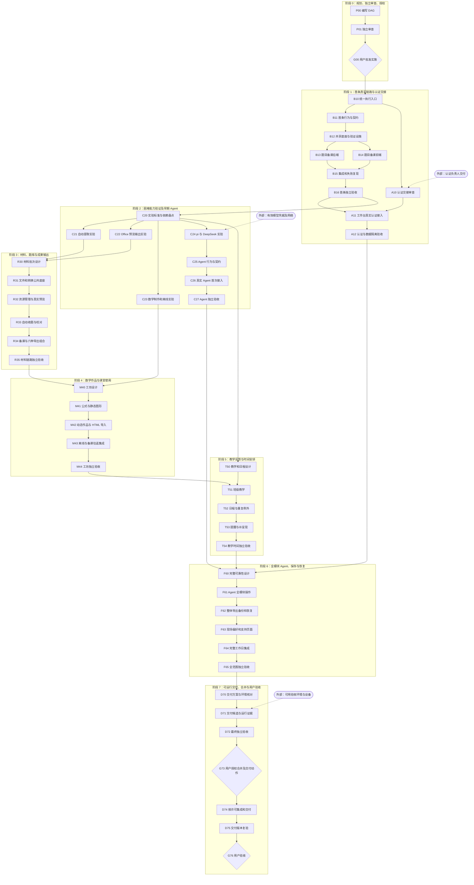

# TeacherWorkspace 真实 MVP 交付 DAG

版本：按读者拆分候选 v2.1，2026-09-21。**G00 已获用户明确授权，开始执行；当前任务与权限以运行台账为准。**

本文是用户检查整体安排、依赖和授权停止点，以及编排者调度的唯一视图。当前执行状态和下一步见[运行台账](run-state.md)。设计、实现和验收 session 从各自任务包进入，不必读取本文。文档拆分的 v2 受审版本已通过[独立审查](mvp-dag-refactor-review.md)；[旧审查](mvp-dag-review.md)只覆盖旧输入哈希。v2.1 只同步已授权的 skill、模型和回执规则，不把旧 PASS 扩展到未受审的新版本，也不为本次普通文档集成追加审查。

## 当前状态与授权停止点

| 对象 | 状态 | 此刻允许的动作 |
| --- | --- | --- |
| P00 | 规划文档拆分及执行规则集成已完成 | 规划准备完成，执行状态见运行台账。 |
| P01 | v2 受审版本独立核验 PASS，报告已归档；v2.1 规则同步不另开复审 | 不把 v2 PASS 扩展为 v2.1 新审查、产品实施或研究修正 PASS。 |
| G00 | 用户已明确批准开始 | 按运行台账的权限范围实施。 |
| B10 及后续节点 | 首批开始派发 | 满足依赖的节点可执行，实际状态见运行台账。 |

旧应用和原型的真实状态见 [README](../../README.md#当前状态)。目前没有真实 MVP。文档集成保留 `5eab55d64463215b7e9c044ffb71edb5c365d0e9` 文档基线，main 基线为 `911e62469a0298339613385b7e4a1f8d90822191`；当前 AGENTS 内容与已有研究文件按授权写入集合保留。

本次已收敛 ROADMAP 执行入口；这不是 B10 的 Git 准备或落地验收。旧文件中的常驻三 Agent、协调者设计/实现/验收、自由互聊等执行描述已被本计划替代；skill 明确要求的有界内部助手由调用 session 管理，不单列 DAG 节点。普通文档修正和状态更新不自动追加审查，阶段文档同步也只是记录动作；PRODUCT_SCOPE 仍独立拥有范围。文档集成所需的 main 合并许可不替代产品实施、部署或发布授权。

## 用户总览

完整 MVP 包含六模块、实际操作这些模块的 Agent、真实身份和持久内容及交付恢复能力。阶段成果只能按该阶段称内部通过。

| 阶段 | 交付成果 | 关键前置或停止点 |
| --- | --- | --- |
| 0 规划与授权 | 可派发的计划及独立审查 | G00 前停止，用户明确同意才实施。 |
| 1 首条链路与认证 | 题目到备课的真实保存；独立认证接入 | 首条流程先建立反馈设施，认证输入到达后尽早接入。 |
| 2 能力验证与早期 Agent | 提取、Office、数学和 pi 实验；真实首批工具 | B16 后开展，四项隔离实验可并行。 |
| 3 材料与成果输出 | 四入口收题、资源预览更新、六种备课输出 | C21/C22 的实际结果进入设计。 |
| 4 数学作品 | 制作、修改、源码、备课往返及离线演示 | C23 与材料链路通过。 |
| 5 教学与时间 | 两班反馈、日程、重复例外与提醒补呈现 | 可先设计；实现等待数学链路完成。 |
| 6 全范围可靠性 | 全模块 Agent、现场、设置、导出和恢复 | 真实认证、早期 Agent 和教学时间链路均通过。 |
| 7 可运行交付 | 固定候选、运行证据、获准交付和用户验收 | G73 核对动作权限，G76 由用户验收。 |

范围到设计、实现和验收的唯一映射在[验收矩阵](../acceptance/mvp-matrix.md#scope)。只有全范围设计/验收需要逐行读取；编排者核对其回执，不自行评判产品覆盖。

## 编排者的读取与派发入口

编排者必读本文、[运行台账](run-state.md)、[执行协议的编排章节](execution-protocol.md#orchestration)及[任务包模板](task-package.md)。任务内容由对应设计者冻结；编排者只派发和检查回执、依赖、权限，不阅读所有实现规则来代做设计或审查。

下表 A/W/用户的模型和责任由执行协议定义。代码实现路由、额度回退、并行调度、最小 prompt 和主动通知均以[编排协议](execution-protocol.md#orchestration)为准；内部助手不成为 DAG 节点。依赖与权限满足的 flow 并行推进，个别节点等用户时继续其他就绪任务。

### 表格如何用于手工派发

- **依赖**是节点的完成门禁。表中保留直接依赖，并列出有必要显式携带的既有传递输入；图仅画主依赖边。节点名称不是输入产物，必须取其固定 PASS 回执。
- **任务入口**是交给设计者或执行者的具体章节；不要求编排者代读其中的实现细节。下游实现者收到本节点任务包，不必沿链接追溯整条 DAG。
- **产物**是任务需要交付的结果。固定相关输入版本、工作边界和完成条件即可派发；内部步骤与文件组织留给执行者，不因没有预列每个文件而停工。
- 每次运行的任务和回执位置为 `.scratch/dag-dispatch/<节点>/<attempt>/task.md` 与 `receipt.md`；正式审查与证据位置为 `docs/acceptance/evidence/<节点>/<revision>/`。这些是未来路径，不表示已存在。
- 表中“阶段文档同步”是阶段状态记录，不自动增加新的审查 session；普通文档修正和状态更新只做必要自检。
- **验收/失败去向**列负责人节点或角色。实现缺陷回实现节点的新 attempt，设计问题回设计节点的新 revision，外部缺口回输入负责人；具体限次见编排协议。

## 整体依赖图

共 8 个阶段、50 个交付节点。EAUTH、EMODEL、EHOST 是外部输入，不是派工节点。认证支线在输入到达后按依赖尽早安排；缺身份时不依赖它的业务可继续，最终身份门槛不变。

## 节点派发表

### 阶段 0：规划、审查与停止点

本阶段产物仅为规划材料和用户决定，不产生产品实现。

| 节点 | 角色与任务入口 | 依赖与输入 | 产物 | 验收与失败去向 |
| --- | --- | --- | --- | --- |
| P00 | A · 规划与修订 | 原始任务、仓库文档基线 | 本 DAG、协议、任务说明及矩阵的固定版本 | P01；缺项回 P00 |
| P01 | A · 独立规划审查 | P00 固定版本、原始任务及同一基线 | 无环/范围/权限/可派发性审查回执 | 供 G00 评阅；缺项回 P00，再由新 A 审查 |
| G00 | 用户 · 实施授权 | P01 PASS、同一计划 revision | 实施与费用/环境/提交/合并权限记录 | 编排者核对原话；未授权则停止 |

### 阶段 1：首条真实链路与认证交接

首条链路建立真实反馈设施。认证交接是独立支线，A12 仍是全范围设计的硬依赖。

| 节点 | 角色与任务入口 | 依赖与输入 | 产物 | 验收与失败去向 |
| --- | --- | --- | --- | --- |
| B10 | A · [入口与所有权](tasks/first-flow.md#b10) | G00；P01、实际 main/diff | 入口核对、分支与所有权清单、落地回执 | 当前为普通文档/Git 准备，由 Luna 必要自检后交回；失败回 B10 |
| B11 | A · [首条设计](tasks/first-flow.md#b11) | B10；本批范围/行为/ADR | `first-flow` 包、工作台契约、B12-B15 任务包 | 独立 A；设计缺口回 B11 |
| B12 | W · [公共底座](tasks/first-flow.md#b12) | B11 冻结包 | 启动/身份接缝、隔离存储、验证设施和自验 | B15 接收、B16 验收；实现回 B12，设计回 B11 |
| B13 | W · [题目备课后端](tasks/first-flow.md#b13) | B12；B11 同版契约 | 模块代码、迁移、API 测试和自验 | B15 接收、B16 验收；实现回 B13，语义回 B11 |
| B14 | W · [前端与外壳](tasks/first-flow.md#b14) | B12；与 B13 相同的 B11 契约 | 页面、外壳、现场及本节点 E2E | B15 接入、B16 验收；实现回 B14，场景回 B11 |
| B15 | W · [首条集成](tasks/first-flow.md#b15) | B13、B14 自验 PASS；B12 | 真实候选、故障/恢复和运行证据 | B16；实现回 B12/B13/B14，契约回 B11 |
| B16 | A · [首条独立验收](../acceptance/mvp-matrix.md#b16) | B15 固定候选 | 首条内部验收回执及阶段文档同步 | FAIL 回 B12-B15 或 B11；PASS 放行 C20/A11 |
| A10 | A · [认证交接审查](tasks/first-flow.md#a10) | B10、EAUTH | `docs/arch/auth-handoff.md`、接入场景和接缝 | 独立 A；交接回 A10，外部缺口交认证负责人 |
| A11 | W · [真实身份与退出](tasks/first-flow.md#a11) | A10、B16 | 工作台认证适配、退出、隔离和集成证据 | A12；工作台回 A11，交接回 A10，认证代码归外部 |
| A12 | A · [身份独立验收](../acceptance/mvp-matrix.md#a12) | A11 固定候选、认证方证据 | 真实身份/跨设备/隔离回执 | FAIL 回 A11/A10/认证方；PASS 供 F60 |

### 阶段 2：困难能力与早期 Agent

实验输入、候选路径和通过标准先冻结，实验原始结果由消费它的独立设计审查复核。

| 节点 | 角色与任务入口 | 依赖与输入 | 产物 | 验收与失败去向 |
| --- | --- | --- | --- | --- |
| C20 | A · [实验标准](tasks/capabilities.md#c20) | B16；B11 风险表 | `docs/arch/capability-checks.md`、样本标准与环境清单 | 独立 A；标准或方案问题回 C20 |
| C21 | W · [自动提取实验](tasks/capabilities.md#c21) | C20 | 隔离样本/输出、`docs/arch/evidence/C21.md` | R30 独立复核；方案回 C20，凭据归外部 |
| C22 | W · [Office 实验](tasks/capabilities.md#c22) | C20 | 隔离样本/对照、`docs/arch/evidence/C22.md` | R30 独立复核；方案回 C20，编辑环境归外部 |
| C23 | W · [数学离线实验](tasks/capabilities.md#c23) | C20 | 源码/离线样本、`docs/arch/evidence/C23.md` | M40 独立复核；方案回 C20，设备归外部 |
| C24 | W · [pi/DeepSeek 实验](tasks/capabilities.md#c24) | C20、EMODEL；B16 服务 | 工具原始轨迹、`docs/arch/evidence/C24.md` | C25 独立复核；方案回 C20，凭据归外部 |
| C25 | A · [Agent 契约](tasks/capabilities.md#c25) | C24；B11/B16 | `agent` 包和 C26 任务包 | 独立 A；契约回 C25，实验不足回 C24/C20 |
| C26 | W · [首批 Agent](tasks/capabilities.md#c26) | C25 | pi 接入、持久对话、首批工具与测试 | C27；实现回 C26，runtime/契约回 C25 |
| C27 | A · [Agent 独立验收](../acceptance/mvp-matrix.md#c27) | C26 固定候选 | 首批 Agent 回执及身份局限 | FAIL 回 C26/C25；PASS 供 F60 |

### 阶段 3：材料、题库与成果输出

本阶段仍是完整 MVP 的一部分，文件格式与导出能力不能因实验结果被静默删减。

| 节点 | 角色与任务入口 | 依赖与输入 | 产物 | 验收与失败去向 |
| --- | --- | --- | --- | --- |
| R30 | A · [材料设计](tasks/materials.md#r30) | C21、C22；B11/B16 | `materials` 包和 R31-R34 任务包 | 独立 A；设计回 R30，方案回 C20 |
| R31 | W · [文件公共底座](tasks/materials.md#r31) | R30 | 文件/转换接缝、迁移与测试 | R32 消费、R35 验收；实现回 R31，规则回 R30 |
| R32 | W · [资源管理预览](tasks/materials.md#r32) | R31 | resources 代码、端口与测试 | R35；实现回 R32/R31，更新语义回 R30 |
| R33 | W · [自动收题校对](tasks/materials.md#r33) | R32；C21、R30 | 导入/校对、题库完整功能与测试 | R35；实现回 R33，方案回 R30/C20 |
| R34 | W · [备课与导出](tasks/materials.md#r34) | R33；C22、R30 | 完整备课、六种输出与测试 | R35；实现回 R34，编辑/引用设计回 R30 |
| R35 | A · [材料独立验收](../acceptance/mvp-matrix.md#r35) | R34；R31-R33 证据 | 材料链路回执与阶段文档同步 | FAIL 回 R31-R34/R30；PASS 供 M40 |

### 阶段 4：数学作品与课堂使用

源码、二次修改、备课往返及无登录离线演示一并交付，支持环境须有实证。

| 节点 | 角色与任务入口 | 依赖与输入 | 产物 | 验收与失败去向 |
| --- | --- | --- | --- | --- |
| M40 | A · [工坊设计](tasks/math.md#m40) | C23、R35；内容/文件契约 | `math` 包和 M41-M43 任务包 | 独立 A；设计回 M40，实验回 C23/C20 |
| M41 | W · [公式与静态素材](tasks/math.md#m41) | M40 | 制作/保存/导出、公共端口和测试 | M44；实现回 M41，能力/模型回 M40 |
| M42 | W · [动态作品与导入](tasks/math.md#m42) | M41；M40 | 动态制作、源码/参数、导入与打包 | M44；实现回 M42，编辑/隔离设计回 M40 |
| M43 | W · [往返与离线集成](tasks/math.md#m43) | M42 | 跨模块适配、离线成果、E2E 和操作清单 | M44；实现回 M41-M43，跨模块规则回 M40/R30 |
| M44 | A · [数学独立验收](../acceptance/mvp-matrix.md#m44) | M43 固定候选、支持环境 | 作品/离线回执与阶段文档同步 | FAIL 回 M41-M43/M40；PASS 供 T51 |

### 阶段 5：班级反馈与时间安排

T50 可以在材料实现期间设计；T51 仍须等待全部可关联对象就绪。

| 节点 | 角色与任务入口 | 依赖与输入 | 产物 | 验收与失败去向 |
| --- | --- | --- | --- | --- |
| T50 | A · [教学日程设计](tasks/teaching-time.md#t50) | C20；B11/B16 端口 | `teaching-time` 包和后续任务包 | 独立 A；规则或端口缺口回 T50 |
| T51 | W · [班级教学](tasks/teaching-time.md#t51) | T50、M44 | 班级记录、备课反馈、关联端口与测试 | T54；实现回 T51，关联规则回 T50 |
| T52 | W · [日程与重复例外](tasks/teaching-time.md#t52) | T51；T50 | 日程、重复计算、业务端口与测试 | T54；实现回 T52，计算/UX 设计回 T50 |
| T53 | W · [提醒和补呈现](tasks/teaching-time.md#t53) | T52；T50 | 提醒存储/计算、通知/跳转和测试 | T54；实现回 T53，时间规则回 T50 |
| T54 | A · [教学时间验收](../acceptance/mvp-matrix.md#t54) | T53；T51-T52 | 教学时间回执与阶段文档同步 | FAIL 回 T51-T53/T50；PASS 供 F60 |

### 阶段 6：全模块 Agent、可靠保存与支持页

设计与验收逐行核对唯一范围矩阵，重测此前仅用开发身份验证的能力。

| 节点 | 角色与任务入口 | 依赖与输入 | 产物 | 验收与失败去向 |
| --- | --- | --- | --- | --- |
| F60 | A · [全范围可靠性设计](tasks/reliability.md#f60) | T54、C27、A12；各阶段覆盖结果 | `reliability` 包、全范围场景/证据索引 | 独立 A；设计回 F60，已有缺口回原模块设计 |
| F61 | W · [全模块 Agent](tasks/reliability.md#f61) | F60；C26、各模块端口 | 全部工具适配与跨模块证据 | F65；实现回 F61，语义回 F60/C25，服务回原模块 |
| F62 | W · [资料导出和恢复](tasks/reliability.md#f62) | F61；F60 | 导出/备份/误删恢复与还原证据 | F65；实现回 F62，恢复规则回 F60 |
| F63 | W · [现场与支持页](tasks/reliability.md#f63) | F62；F60 | 现场/偏好、设置帮助和真实发布记录 | F65；实现回 F63，现场层次设计回 F60 |
| F64 | W · [完整工作日集成](tasks/reliability.md#f64) | F63；全部已通过模块版本 | 完整真实身份候选、跨模块 E2E 与证据 | F65；实现回原节点，设计冲突回 F60 指定拥有者 |
| F65 | A · [全范围独立验收](../acceptance/mvp-matrix.md#f65) | F64；A12、矩阵逐行证据 | 全功能内部回执与阶段文档同步 | FAIL 归原拥有者；PASS 供 D70，仍未交付 |

### 阶段 7：交付、合并与用户验收

先形成用户可检查的运行成果，再核对仍缺的动作权限；最终交付版本另行复验。

| 节点 | 角色与任务入口 | 依赖与输入 | 产物 | 验收与失败去向 |
| --- | --- | --- | --- | --- |
| D70 | A · [交付方案](tasks/delivery.md#d70) | F65；C20 环境清单及实验依赖 | `delivery` 包、具体交付动作与支持环境 | 独立 A；设计回 D70，环境/权限缺口归外部 |
| D71 | W · [交付候选](tasks/delivery.md#d71) | D70、EHOST | 固定 SHA、验收 URL、干净启动/恢复说明 | D72；配置回 D71，设计回 D70，外部条件 BLOCKED |
| D72 | A · [最终候选验收](../acceptance/mvp-matrix.md#d72) | D71；F65 全证据 | 最终验收报告、范围和缺陷结论 | 供 G73；失败回 D71 或原实现/设计 |
| G73 | 用户 · 动作授权 | D72 PASS、revision/diff 和动作清单 | 逐动作授权记录，见下方用户门禁 | 编排者核对已有许可；未覆盖动作停止 |
| D74 | W · [获准集成交付](tasks/delivery.md#d74) | G73；D72 固定候选 | 最终 commit、制品、地址及迁移前备份 | D75；冲突/构建回 D74，行为回原节点；新候选先交新 A |
| D75 | A · [交付版本复验](../acceptance/mvp-matrix.md#d75) | D74 最终 revision/制品/地址 | 复验回执及实际交付版本记录 | 供 G76；缺陷回 D74 或原拥有者 |
| G76 | 用户 · 最终验收 | D75、最终入口、范围映射和限制 | 用户明确的完整 MVP 验收结果 | 反馈交原节点的新 session，必要时产生新版本 |

## 用户门禁

### G00 实施授权

新 P01 PASS 后，用户对同一计划 revision 明确是否允许实施，记录允许的环境/费用范围及是否包含提交或 main 合并权限。未明确的权限仍未授予；沉默、超时和内部 PASS 均不构成授权。范围内普通按钮、字段和技术选择由设计者负责，不逐项回问用户。

### G73 合并及交付动作

D72 通过后，分别核对 `merge_main`、目标 revision、推送、公开部署、Release PR、Tag/发布的权限。用户已经给予且覆盖同范围的持续许可可直接引用，不重复索要。未覆盖的动作停在可运行交付分支；实施许可不自动等于合并或发布许可。

### G76 用户验收

只有用户明确验收才写用户验收通过。范围内仍有缺项就保持未完成，不把部分能力改名为更小的 MVP。编排者只记录决定，不代用户接受。

## 外部依赖与失败归属

| 输入 | 首次核对 | 硬门禁与负责人 |
| --- | --- | --- |
| EAUTH：真实认证、契约、邮件/会话及备份交接 | B10/A10 | 外部认证负责人提供；A12 未过不能进 F60，工作台不越界修认证。 |
| EMODEL：模型凭据、配额与网络；允许模型和接入限制以[Command Code API 研究](../research/command-code-api.md#allowed-models)为准；按选型需要的 OCR | C20/C24，C21 按需 | 缺实际调用条件则相应节点 BLOCKED，由条件提供者补齐。 |
| Office 转换、字体、真编辑环境与代表材料 | C20/C22 | R30/R35 不能把未验证格式或公式写为支持；工具选择由设计者裁决。 |
| 课堂浏览器、断网冷启动、桌面/Pad 设备 | C20/C23 | M44/D72 只报告实测支持环境，缺必要环境则相应节点 BLOCKED。 |
| EHOST：已获准的验收主机、HTTPS、持久目录及备份位置 | C20 初查、D70 复核 | D71 无条件则 BLOCKED，可用已授权本机/局域网路径，不擅自采购或公开发布。 |
| 指定模型/effort、现有完成通知接口 | 派发时 | 启动结果才证明可用；失败按协议回执，不新增调度平台。 |

## 当前执行边界

用户已通过 G00，实施与本地验证开始。当前节点、候选版本和权限以运行台账为准；未获得的公开部署、发布与推送权限不由实施许可推导。
