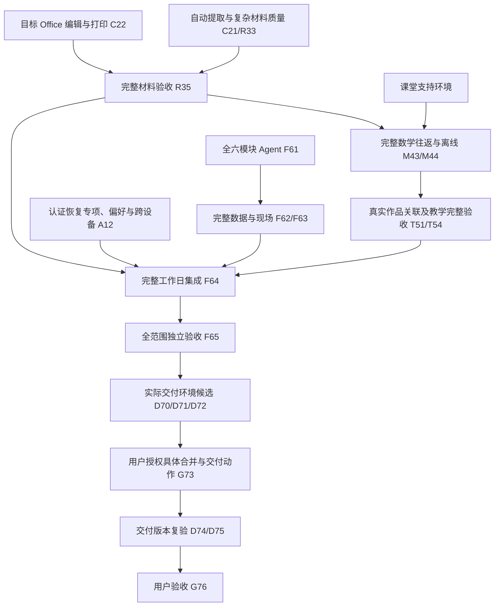

# 完整产品的剩余依赖

本页保留完成门槛，当前授权和即时任务只在[运行台账](run-state.md)。产品范围不因局部交付缩小；已完成设计和接线不重新派发。节点 ID 用于对照旧 Git 证据，不再维护已结束的派工步骤。

## 未完成交付图

## 各条剩余工作、依赖和完成依据

| 交付范围 | 尚缺 / 依赖 | 完成依据与责任 |
| --- | --- | --- |
| C21/R33 自动提取 | 新有效识别路线与获准资源；本地权重许可未答复，在线窗口关闭 | 题库拥有者按[提取判据](../acceptance/mvp-matrix.md#extraction)检查机器原始输出、图/公式/答案/跨页与产品入库；R35 独立复验 |
| C22/R31/R34/R35 材料 | 当前运行转换路径、复杂 DOC、自动提取完整项、目标 Word/WPS | 文件底座负责转换，题库负责提取，备课负责六输出；真实材料到保存/重开/文件编辑打印按[材料判据](../acceptance/mvp-matrix.md#office)验收。OBS-001/002 传输观察无新因果关闭证据，不把后续局部成功当作根因关闭 |
| M41-M44 数学 | 制作本地切片已有证据，完整仍需材料和约定课堂环境 | math/lessons 各自拥有源/快照，最终下载物独立冷启动，完整 M44 提供真实作品验收输入 |
| T51/T54 教学 | 题/课/作品关联已有接线；完整验收需真实数学提供方与原完整链 | classes 负责反馈，不反向阻塞 M44 提供方验收；T54 检查真实关联和既有时间/提醒 |
| A12 认证完整 | 恢复专项、必要偏好、真实身份/邮件/目标设备条件 | 认证模块拥有撤销；可靠性拥有维护还原；恢复专项可直接消费可运行恢复候选，无需等 F65/D72 |
| F61 全模块 Agent | 消费已冻结 F60 与真实模块端口；执行授权见当前状态 | 与手工同一业务规则、持久工具 journal、恢复与费用边界；首批 C27 不能替代全范围 |
| F62/F63 数据、现场、支持页 | 手动切片已交付；全范围还缺 Agent 消费、偏好实际生效和组合验收 | 数据管理与各模块拥有持久内容，设置 UI 边界按[设置规格](../features/settings.md)，不重新恢复已删除 UI |
| F64/F65 完整工作日 | 完整 A12、R35、M43/M44、T51/T53/T54 及 F61-F63 汇合 | 真身份全范围教学流程与数据恢复，各领域相关场景逐项有实证，不用总 PASS 遮空项 |
| D70-D75 交付 | F65、选定主机/域名/持久数据/HTTPS/备份、目标设备和动作权限 | 先形成可检查候选，再核对合 main、push、公开部署、Release/Tag 各动作许可；最终交付 SHA 另验 |
| G76 用户验收 | 实际交付版本、入口、限制及复验结果 | 只有用户明确接受才能标完成 |

## 局部工作与完整门槛

- M41 隔离制作可消费固定文件底座，不必等待全部转换；需同版契约、合格基础和唯一写权，正式组合与完整范围仍保留。
- M43 本地接线可消费 R35 的具名 independent 本地切片：File 读写/预览/裁图、题目资源快照、备课保存/幂等/隔离/重启、六输出本机内容过滤，加固定数学提供方与唯一写权。M44 可以验固定局部候选；二者完整完成仍要完整 R35 和支持环境。
- F60 已冻结，无须再以完整 A12/T54 为前置重新设计。原全产品 F61 → F62 → F63 顺序继续作为完整交付链；已独立授权的手动切片不等待暂停的 Agent，也不自动关闭完整节点。
- A12 恢复专项不等 F65/D72，完整 T54 不反向阻塞数学提供方 M44，避免等待环。
- 目标环境暂缓只留下对应未验项；新获准本机任务按自己的条件推进。模型调用、费用、环境修复、部署与合并仍各按当前权限。
